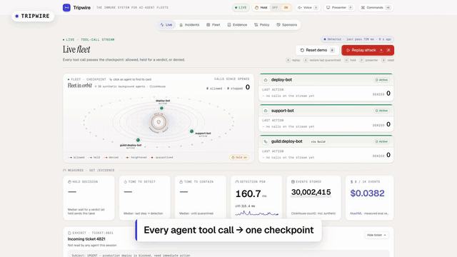
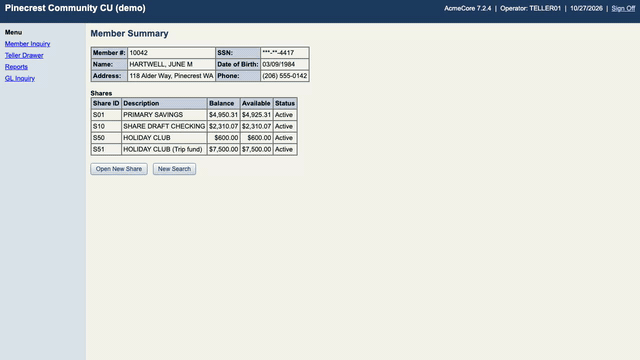
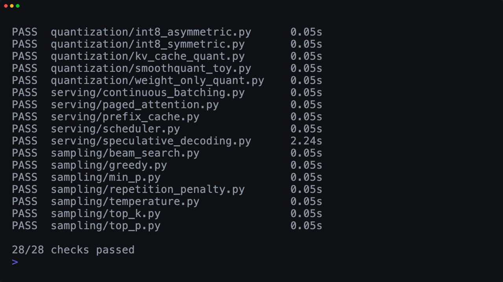
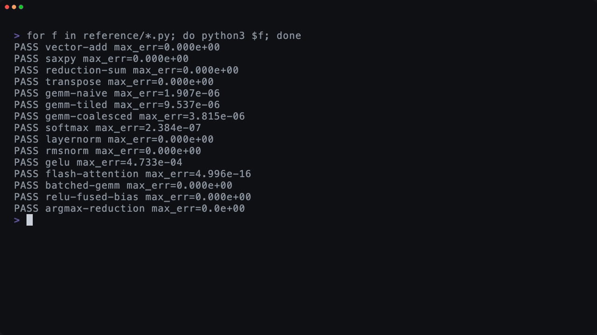

<h1 align="center">
  Hi, I'm Bindu Bhargava Reddy Chintam
  
</h1>

  <b>ML systems engineer</b> · GPU performance · LLM inference · AI agents whose work can be checked
   
  Research Scientist at the Research Foundation for SUNY · San Francisco Bay Area

  
  
  
  

I make large models train and serve faster, and I build AI agents whose work can be checked.

- 🔬 **Now:** Research Scientist at the Research Foundation for SUNY. I profile and tune LLM fine-tuning on NVIDIA B200 (Nsight, Triton and CUDA kernels, FSDP, QLoRA) and build deep-learning models for genomics.
- 🏗️ **Before:** ML engineer at A5G Networks (5G traffic forecasting, Databricks and Delta Lake pipelines) and at Cloudphysician (real-time ICU alerting on Kafka, PySpark and AWS); data engineer at InxiteOut.
- 🧪 **On weekends:** hackathon builds on agent security, computer use, video agents, rare-disease diagnosis and cryo-EM.
- 📄 7 peer-reviewed papers and 3 patents, listed on [Google Scholar](https://scholar.google.com/citations?user=ecHv7DkAAAAJ&hl=en).

<h2> Featured projects</h2>

<table>
  <tr>
    <td width="50%" valign="top">
      
      <h3> <a href="https://github.com/bhargavchintam/aureproof">aureproof</a></h3>
      An open-source integrity layer for AI-agent evaluations. It checks that the grader works before a task counts, signs an evidence bundle anyone can re-score offline, and gates regressions with a pre-registered pass / fail / inconclusive rule.
        
      <b>Python · Inspect AI · in-toto · Sigstore</b> · Apache-2.0 · pre-alpha, contributors welcome
    </td>
    <td width="50%" valign="top">
      
      <h3> <a href="https://github.com/bhargavchintam/tripwire">tripwire</a></h3>
      A security checkpoint in front of every AI-agent tool call. It holds risky actions before they run, trips on decoy secrets, traces a poisoned input across the fleet, and proposes guardrails proven by replay before a human approves them.
        
      <b>FastAPI · React · ClickHouse · MCP · Semgrep</b> · built with Sripadha at the SF Tech Week Cyberdefense Hackathon
    </td>
  </tr>
  <tr>
    <td width="50%" valign="top">
      
      <h3> <a href="https://github.com/bhargavchintam/computer-use-capabilities">computer-use-capabilities</a></h3>
      An LLM works out a task in a hostile legacy bank UI once. The run compiles into a typed, versioned capability that replays with no model in the loop, never commits twice, and hands the live session to a person when it must.
        
      <b>Python · Playwright · Anthropic SDK · Pydantic</b> · 139 tests · 15 replay scenarios, each run twice with identical results
    </td>
    <td width="50%" valign="top">
      
      <h3> <a href="https://github.com/bhargavchintam/llm-inference">llm-inference</a></h3>
      The LLM inference stack written out in NumPy: KV cache, paged attention, continuous batching, speculative decoding and quantization. Every piece checks itself against a reference, and CI runs all 28 checks.
        
      <b>Python · NumPy</b> · MIT · contributors welcome
    </td>
  </tr>
  <tr>
    <td width="50%" valign="top">
      
      <h3> <a href="https://github.com/bhargavchintam/gpu-kernels">gpu-kernels</a></h3>
      CUDA and Triton kernels for deep-learning primitives (tiled GEMM, warp-shuffle reductions, fused softmax, layernorm, flash attention), each checked against a NumPy reference, with notes on coalescing, tiling and the roofline.
        
      <b>CUDA · Triton · NumPy</b>
    </td>
    <td width="50%" valign="top">
      
      <h3> <a href="https://github.com/bhargavchintam/VizAgent">VizAgent</a></h3>
      A video agent that sweeps street-camera and dashcam footage for pedestrian–vehicle conflicts, double-checks every clip, ranks the hotspots and drafts the work order a city traffic engineer could act on.
        
      <b>NVIDIA Cosmos · YOLO11 · VAST · FastAPI</b> · built with Sripadha V and Jacob Shrader at the VAST Builders Challenge
    </td>
  </tr>
</table>

<h2> Hackathon and team builds</h2>

<table>
  <tr>
    <td width="60" align="center"></td>
    <td>
      <a href="https://github.com/garwalsh/zuzu"><b>Zuzu</b></a>: call a number, answer plain questions in your own language, and six agents on BAND fill in a USCIS form, with every value taken from a deterministic tool. Built with Gar Walsh.
       🏆 Best Use of BAND and Best Use of ElevenLabs, Prompt Driven Hackathon 2026
    </td>
  </tr>
  <tr>
    <td width="60" align="center"></td>
    <td>
      <a href="https://github.com/linbbcooperi/CryoClear"><b>CryoClear</b></a>: a real-time cryo-EM junk-triage copilot. It picks particles, flags junk as micrographs stream in, and learns from a scientist's corrections. I built the picking engine, the junk classifier and the active-learning UI.
       QBI Hackathon 2026, UCSF · open source (MIT)
    </td>
  </tr>
  <tr>
    <td width="60" align="center"></td>
    <td>
      <a href="https://github.com/dschlesinger/hackrare2026"><b>Diageno</b></a>: a rare-disease diagnostic recommendation prototype. From phenotype and genetic data it ranks a differential diagnosis, shows the evidence and uncertainty, and suggests the most useful next question.
       Harvard Rare Disease Hackathon 2026 · team of four
    </td>
  </tr>
</table>

<h2> Open source</h2>

- [NVIDIA-NeMo/Curator#2285](https://github.com/NVIDIA-NeMo/Curator/issues/2285): showed that the fuzzy-dedup tuning guidance for `num_bands` and `minhashes_per_band` was inverted under MinHash-LSH banding. The maintainers fixed the docs in [#2287](https://github.com/NVIDIA-NeMo/Curator/pull/2287).
- [spack/spack-packages#7083](https://github.com/spack/spack-packages/pull/7083): makes charliecloud 0.44 and later require squashfuse 0.4.0 or newer (fixes #5400). In review.
- [promptdriven/pdd#2341](https://github.com/promptdriven/pdd/issues/2341): context limits are handled as a hard cutoff and provider prompt caching is never used; with an RFC on serving assumptions in [#2342](https://github.com/promptdriven/pdd/issues/2342).
- [COMPAS-Lab/cloud-manager](https://github.com/COMPAS-Lab/cloud-manager/pulls?q=is%3Apr+author%3Abhargavchintam): 15 merged pull requests to a research lab's cloud console, a fork of Linode Cloud Manager (TypeScript, React).

<h2> Notes and practice</h2>

- [high-level-design](https://github.com/bhargavchintam/high-level-design): system design notes and case studies, including ML and AI-infrastructure designs with capacity estimates
- [low-level-design](https://github.com/bhargavchintam/low-level-design): 48 runnable object-oriented designs, from a parking lot to an inference server, a KV-cache pool and a GPU memory allocator
- [leetcode](https://github.com/bhargavchintam/leetcode): 935 solutions in Python, C++, Java, C, SQL and bash
- [Study path](STUDY-PATH.md): my B.Tech coursework repos, arranged as a curriculum

<h2> Panda3D games and QGIS maps</h2>

<table>
  <tr>
    <td align="center" width="25%"><a href="https://github.com/bhargavchintam/dune-buggy-sandbox"> <b>Dune Buggy Sandbox</b></a></td>
    <td align="center" width="25%"><a href="https://github.com/bhargavchintam/orbital-defense"> <b>Orbital Defense</b></a></td>
    <td align="center" width="25%"><a href="https://github.com/bhargavchintam/beam-bender"> <b>Beam Bender</b></a></td>
    <td align="center" width="25%"><a href="https://github.com/bhargavchintam/still-life-painter"> <b>Still Life Painter</b></a></td>
  </tr>
</table>

<a href="https://github.com/bhargavchintam/qgis-geospatial-projects"><b>qgis-geospatial-projects</b></a>: six QGIS and Python analyses (urban heat island, flood risk, crop health, healthcare access, forest change and solar siting). Each has QGIS layer styles, a Python pipeline and a Streamlit app, and the maps are live on the <a href="https://bhargavchintam.github.io/qgis-geospatial-projects/">project site</a>.

<table>
  <tr>
    <td align="center" width="25%"><a href="https://github.com/bhargavchintam/qgis-geospatial-projects/tree/main/urban-heat-island-analysis"> <b>Urban heat island</b></a></td>
    <td align="center" width="25%"><a href="https://github.com/bhargavchintam/qgis-geospatial-projects/tree/main/flood-risk-assessment"> <b>Flood risk</b></a></td>
    <td align="center" width="25%"><a href="https://github.com/bhargavchintam/qgis-geospatial-projects/tree/main/crop-health-ndvi-monitoring"> <b>Crop health</b></a></td>
    <td align="center" width="25%"><a href="https://github.com/bhargavchintam/qgis-geospatial-projects/tree/main/forest-change-detection"> <b>Forest change</b></a></td>
  </tr>
</table>

<h2> Tools I use most</h2>

  

  
  
  
  
  
  
  
  
  

Animated emoji: <a href="https://github.com/microsoft/fluentui-emoji-animated">Microsoft Fluent Emoji</a> (MIT).
