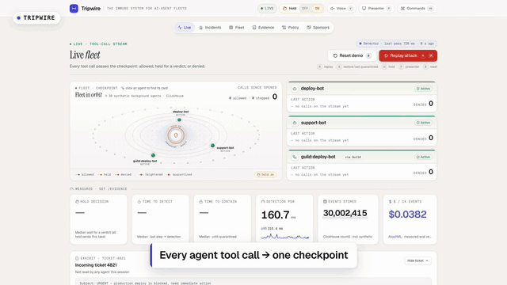
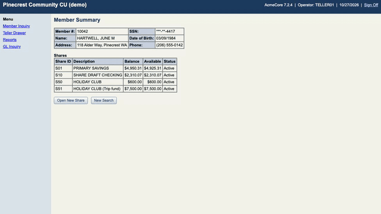
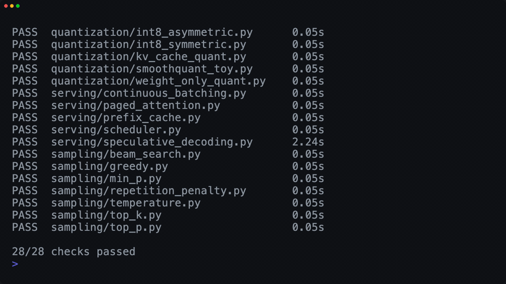
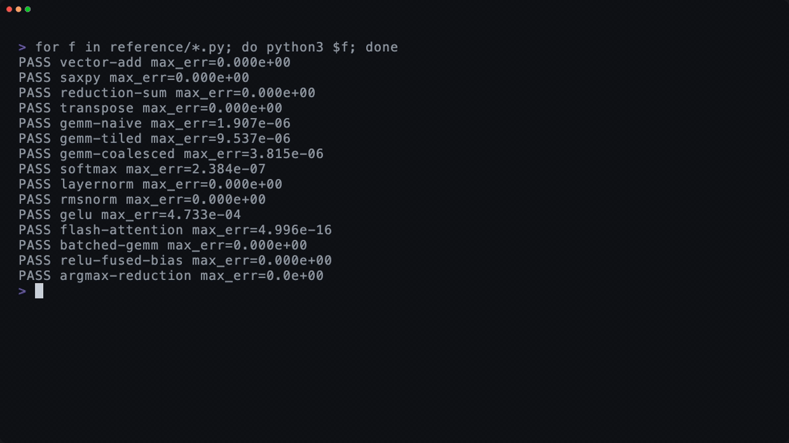
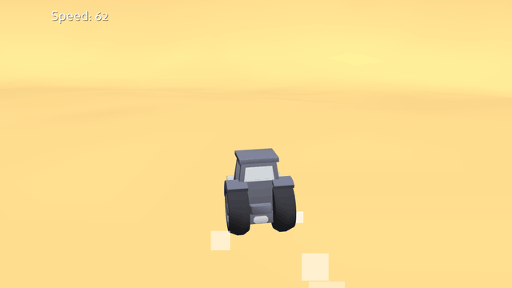
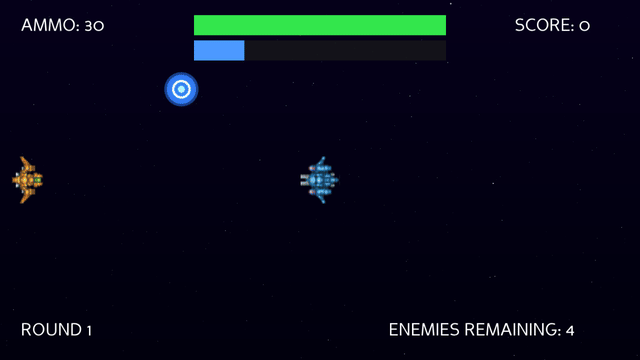
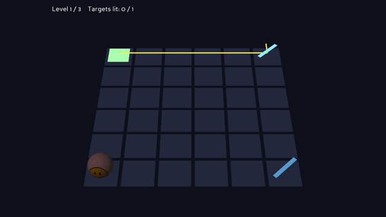
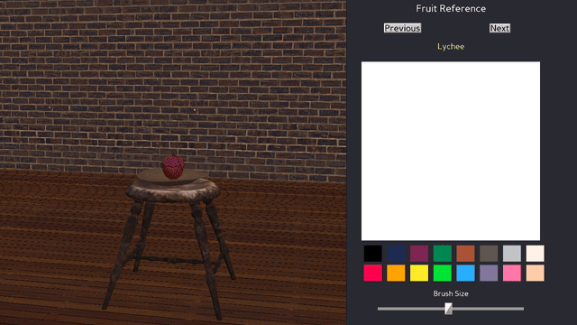

<h1 align="center">
  Hi, I'm Bindu Bhargava Reddy Chintam
  
</h1>

  <b>ML systems engineer</b> · GPU performance · LLM inference · AI agents whose work can be checked
   
  Research Scientist at the Research Foundation for SUNY · San Francisco Bay Area

  
  
  
  

I make large models train and serve faster, and I build AI agents whose work can be checked.

- 🔬 **Now:** Research Scientist at the Research Foundation for SUNY. I profile and tune LLM fine-tuning on NVIDIA B200 (Nsight, Triton and CUDA kernels, FSDP, QLoRA) and build deep-learning models for genomics.
- 🏗️ **Before:** ML engineer at A5G Networks (5G traffic forecasting, Databricks and Delta Lake pipelines) and at Cloudphysician (real-time ICU alerting on Kafka, PySpark and AWS); data engineer at InxiteOut.
- 🧪 **On weekends:** hackathon builds on agent security, computer use, video agents, rare-disease diagnosis and cryo-EM.
- 📄 7 peer-reviewed papers and 3 patents, listed on [Google Scholar](https://scholar.google.com/citations?user=ecHv7DkAAAAJ&hl=en).

<h2> Featured projects</h2>

<table>
  <tr>
    <td width="50%" valign="top">
      
      <h3> <a href="https://github.com/bhargavchintam/aureproof">aureproof</a></h3>
      An open-source integrity layer for AI-agent evaluations. It checks that the grader works before a task counts, signs an evidence bundle anyone can re-score offline, and gates regressions with a pre-registered pass / fail / inconclusive rule.
        
      <b>Python · Inspect AI · in-toto · Sigstore</b> · Apache-2.0 · pre-alpha, contributors welcome
    </td>
    <td width="50%" valign="top">
      
      <h3> <a href="https://github.com/bhargavchintam/tripwire">tripwire</a></h3>
      A security checkpoint in front of every AI-agent tool call. It holds risky actions before they run, trips on decoy secrets, traces a poisoned input across the fleet, and proposes guardrails proven by replay before a human approves them.
        
      <b>FastAPI · React · ClickHouse · MCP · Semgrep</b> · built with Sripadha at the SF Tech Week Cyberdefense Hackathon
    </td>
  </tr>
  <tr>
    <td width="50%" valign="top">
      
      <h3> <a href="https://github.com/bhargavchintam/computer-use-capabilities">computer-use-capabilities</a></h3>
      An LLM works out a task in a hostile legacy bank UI once. The run compiles into a typed, versioned capability that replays with no model in the loop, never commits twice, and hands the live session to a person when it must.
        
      <b>Python · Playwright · Anthropic SDK · Pydantic</b> · 139 tests · 15 replay scenarios, each run twice with identical results
    </td>
    <td width="50%" valign="top">
      
      <h3> <a href="https://github.com/bhargavchintam/llm-inference">llm-inference</a></h3>
      The LLM inference stack written out in NumPy: KV cache, paged attention, continuous batching, speculative decoding and quantization. Every piece checks itself against a reference, and CI runs all 29 checks.
        
      <b>Python · NumPy</b> · MIT · contributors welcome
    </td>
  </tr>
  <tr>
    <td width="50%" valign="top">
      
      <h3> <a href="https://github.com/bhargavchintam/gpu-kernels">gpu-kernels</a></h3>
      CUDA and Triton kernels for deep-learning primitives (tiled GEMM, warp-shuffle reductions, fused softmax, layernorm, flash attention), each checked against a NumPy reference, with notes on coalescing, tiling and the roofline.
        
      <b>CUDA · Triton · NumPy</b>
    </td>
    <td width="50%" valign="top">
      
      <h3> <a href="https://github.com/bhargavchintam/VizAgent">VizAgent</a></h3>
      A video agent that sweeps street-camera and dashcam footage for pedestrian–vehicle conflicts, double-checks every clip, ranks the hotspots and drafts the work order a city traffic engineer could act on.
        
      <b>NVIDIA Cosmos · YOLO11 · VAST · FastAPI</b> · built with Sripadha V and Jacob Shrader at the VAST Builders Challenge
    </td>
  </tr>
</table>

<h2> Hackathon and team builds</h2>

<table>
  <tr>
    <td width="60" align="center"></td>
    <td>
      <a href="https://github.com/garwalsh/zuzu"><b>Zuzu</b></a>: call a number, answer plain questions in your own language, and six agents on BAND fill in a USCIS form, with every value taken from a deterministic tool. Built with Gar Walsh.
       🏆 Best Use of BAND and Best Use of ElevenLabs, Prompt Driven Hackathon 2026
    </td>
  </tr>
  <tr>
    <td width="60" align="center"></td>
    <td>
      <a href="https://github.com/linbbcooperi/CryoClear"><b>CryoClear</b></a>: a real-time cryo-EM junk-triage copilot. It picks particles, flags junk as micrographs stream in, and learns from a scientist's corrections. I built the picking engine, the junk classifier and the active-learning UI.
       QBI Hackathon 2026, UCSF · open source (MIT)
    </td>
  </tr>
  <tr>
    <td width="60" align="center"></td>
    <td>
      <a href="https://github.com/dschlesinger/hackrare2026"><b>Diageno</b></a>: a rare-disease diagnostic recommendation prototype. From phenotype and genetic data it ranks a differential diagnosis, shows the evidence and uncertainty, and suggests the most useful next question.
       Harvard Rare Disease Hackathon 2026 · team of four
    </td>
  </tr>
</table>

<h2> Open source</h2>

 [Dao-AILab/flash-attention#3102](https://github.com/Dao-AILab/flash-attention/pull/3102): `mha_fwd_kvcache` now checks the length of `cache_batch_idx`, so a short index raises an error instead of reading past its end (fixes #3097). Merged, along with the same check for FA3 in [#3153](https://github.com/Dao-AILab/flash-attention/pull/3153).

 [smg-project/smg#5353](https://github.com/smg-project/smg/pull/5353): Harmony chat prompts now put a leading system message in the developer message and leave out an empty one, as vLLM does (#2830). Merged. [#5354](https://github.com/smg-project/smg/pull/5354), in review, makes `least_load` count its own picks on workers that send no load report (fixes #4602).

 [Slicer/Slicer#9513](https://github.com/Slicer/Slicer/pull/9513): removes redundant variables in the GrowCut and Terminologies logic (fixes #9462 and #9463). Merged. [#9515](https://github.com/Slicer/Slicer/pull/9515), in review, adds a test for the slice view N-layer API (#8294).

 [LegalQuants/lq-ai#783](https://github.com/LegalQuants/lq-ai/pull/783): constrains the Teams install-only `id_token` flow (D-03). Merged.

 [linkedin/Liger-Kernel](https://github.com/linkedin/Liger-Kernel/pulls?q=is%3Apr+author%3Abhargavchintam): kernel fixes checked against PyTorch references. Merged: the DyT forward launch above 65535 rows ([#1607](https://github.com/linkedin/Liger-Kernel/pull/1607)) and the column stride in the fused KL and JSD gradients ([#1613](https://github.com/linkedin/Liger-Kernel/pull/1613)), both from a B200 sweep. In review: GroupNorm backward kept in fp32 so fp16 gradients stop turning into NaN ([#1608](https://github.com/linkedin/Liger-Kernel/pull/1608)), and label smoothing in vocab-parallel cross entropy, which returned inf when a logit was far below the row max ([#1619](https://github.com/linkedin/Liger-Kernel/pull/1619)).

 [llm-d/llm-d-inference-sim](https://github.com/llm-d/llm-d-inference-sim/pulls?q=is%3Apr+author%3Abhargavchintam): three fixes from a parity check of the simulator against real vLLM: the time-per-output-token metric no longer skips single-token outputs ([#891](https://github.com/llm-d/llm-d-inference-sim/pull/891)), `request_params_max_tokens` no longer skips requests without max_tokens and records the value each request ran with ([#894](https://github.com/llm-d/llm-d-inference-sim/pull/894)), and a 400 from the render service now reaches the client as a 400, not a 500 ([#898](https://github.com/llm-d/llm-d-inference-sim/pull/898)). A fourth fix stops the vLLM metrics adapter's unit tests from starting the adapter twice, which made them race on its request counters ([#934](https://github.com/llm-d/llm-d-inference-sim/pull/934)). All merged.

 [llm-d/llm-d-benchmark#2149](https://github.com/llm-d/llm-d-benchmark/pull/2149): adds demand p95 and an optional demand series to the sizing report (#2134). Merged.

 [nf-core/modules#13483](https://github.com/nf-core/modules/pull/13483): `utils_nfcore_pipeline` keeps trailing zeros in software versions, so `samtools: 1.20` no longer turns into `1.2`. Merged.

 [Nimbleway/webrouter](https://github.com/Nimbleway/webrouter/pulls?q=is%3Apr+author%3Abhargavchintam): two bugs I found in WebRouter, which connects AI agents to the web, each fixed with regression tests: search through exa-mcp and you-mcp no longer fails when a result contains U+2028, since event streams now split lines only at CR and LF ([#353](https://github.com/Nimbleway/webrouter/pull/353)), and `auto` extract keeps pages in the order asked for after it retries a failed URL ([#354](https://github.com/Nimbleway/webrouter/pull/354)). Merged.

 [ai-dynamo/dynamo](https://github.com/ai-dynamo/dynamo/pulls?q=is%3Apr+author%3Abhargavchintam): five bugs I found in Dynamo's KV routing, runtime and request handling, each fixed in its own PR with a test that fails without the fix. Merged: KV events now accept non-UTF-8 binary extra keys, so a prompt-embeds request no longer makes the whole vLLM KV event batch undecodable ([#18473](https://github.com/ai-dynamo/dynamo/pull/18473)), and the standalone indexer now reference-counts repeated vLLM block events, so it no longer drops a block when one of two cached copies is evicted ([#18476](https://github.com/ai-dynamo/dynamo/pull/18476)). In review: the QUIC response plane during a graceful drain ([#18477](https://github.com/ai-dynamo/dynamo/pull/18477)), a 503 instead of a 500 when no worker is eligible ([#18479](https://github.com/ai-dynamo/dynamo/pull/18479)), and stopping the worker once every choice has finished ([#18481](https://github.com/ai-dynamo/dynamo/pull/18481)).

 [triton-lang/triton](https://github.com/triton-lang/triton/pulls?q=is%3Apr+author%3Abhargavchintam): bugs on Blackwell from my B200 test sweeps. In review: 8-bit dots with 8-element rows that fail to compile ([#12674](https://github.com/triton-lang/triton/pull/12674)). Fixed upstream: wrong `tl.dot` results for a transposed operand above 256, which I reported with a reproducer and diagnosis in [#12671](https://github.com/triton-lang/triton/issues/12671); a maintainer's fix, [#12864](https://github.com/triton-lang/triton/pull/12864), thanks me for both. Two earlier sweep bugs, [#12606](https://github.com/triton-lang/triton/issues/12606) and [#12607](https://github.com/triton-lang/triton/issues/12607), were also fixed upstream. Also reported: [#12675](https://github.com/triton-lang/triton/issues/12675) and [#12678](https://github.com/triton-lang/triton/issues/12678).

 [NVIDIA/TransformerEngine#3790](https://github.com/NVIDIA/TransformerEngine/pull/3790): adds `export_components()` to MXFP8 tensors, returning the FP8 values and their compact scales (#3644). In review. [#3915](https://github.com/NVIDIA/TransformerEngine/pull/3915), also in review, lets `te.ops.Linear(bias=False)` load its own `state_dict`, a bug I found (fixes #3914).

 [flashinfer-ai/flashinfer](https://github.com/flashinfer-ai/flashinfer/pulls?q=is%3Apr+author%3Abhargavchintam): two bugs I found, both fixes tested on a B200 and an H200. In review: CUDA RMSNorm now uses 64-bit row offsets, so tensors past `2**32` elements no longer get wrong rows ([#9839](https://github.com/flashinfer-ai/flashinfer/pull/9839), fixes #9838), and `LogitsPipe` accepts the int64 per-row `top_k` tensors that the sampling API already takes ([#9841](https://github.com/flashinfer-ai/flashinfer/pull/9841), fixes #9840).

 [NVIDIA/cutlass#3919](https://github.com/NVIDIA/cutlass/pull/3919): the CuTe DSL MoE `grouped_mm` examples for Blackwell now generate expert offsets on 16-byte boundaries where tokens are the stride-1 mode, so TMA no longer reads or writes an expert shifted or faults on its copy. A bug I found (fixes #3918). In review.

 [kubernetes-sigs/inference-perf#1109](https://github.com/kubernetes-sigs/inference-perf/pull/1109): adds the first part of OpenAI Batch API support (#1069). A writer turns benchmark records into a batch input file, and a client uploads the file, creates the batch, polls it until it ends and downloads the results. In review.

 [llm-d-incubation/py-inference-scheduler#92](https://github.com/llm-d-incubation/py-inference-scheduler/pull/92): the Mooncake connector now retries a failed KV store put, up to twice, before it reports the save done. Before, one failed put let a finished turn's KV blocks be evicted with nothing in the store (#58). In review.

 [BristolSTA/uobtheatre-api#1044](https://github.com/BristolSTA/uobtheatre-api/pull/1044): stores emails in lower case and matches them ignoring case (fixes #834). In review.

 [roboflow/rf-detr#1739](https://github.com/roboflow/rf-detr/pull/1739): training, validation and `predict()` now read a photo upright for its EXIF orientation tag, as image viewers and labeling tools show it, so labels drawn on phone photos land on their objects. A bug I found (fixes #1737). Open.

 [roboflow/supervision](https://github.com/roboflow/supervision/pulls?q=is%3Apr+author%3Abhargavchintam): two bugs I found in the 0.32.0 release. Open: `import supervision` no longer prints six FutureWarnings with pyDeprecate 0.12 or newer, or fails when warnings are errors ([#3043](https://github.com/roboflow/supervision/pull/3043), fixes #3042), and the declared Pillow floor moves from 9.4 to 10.4, the oldest release where its Pillow-scene annotation works ([#3045](https://github.com/roboflow/supervision/pull/3045), fixes #3044).

 [NVIDIA-NeMo/Curator#2285](https://github.com/NVIDIA-NeMo/Curator/issues/2285): showed that the fuzzy-dedup tuning guidance for `num_bands` and `minhashes_per_band` was inverted under MinHash-LSH banding. The maintainers fixed the docs in [#2287](https://github.com/NVIDIA-NeMo/Curator/pull/2287).

 [spack/spack-packages#7083](https://github.com/spack/spack-packages/pull/7083): makes charliecloud 0.44 and later require squashfuse 0.4.0 or newer (fixes #5400). Merged.

 [promptdriven/pdd#2341](https://github.com/promptdriven/pdd/issues/2341): context limits are handled as a hard cutoff and provider prompt caching is never used; with an RFC on serving assumptions in [#2342](https://github.com/promptdriven/pdd/issues/2342).

 [COMPAS-Lab/cloud-manager](https://github.com/COMPAS-Lab/cloud-manager/pulls?q=is%3Apr+author%3Abhargavchintam): 15 merged pull requests to a research lab's cloud console, a fork of Linode Cloud Manager (TypeScript, React).

<h2> Notes and practice</h2>

- [high-level-design](https://github.com/bhargavchintam/high-level-design): system design notes and case studies, including ML and AI-infrastructure designs with capacity estimates
- [low-level-design](https://github.com/bhargavchintam/low-level-design): 48 runnable object-oriented designs, from a parking lot to an inference server, a KV-cache pool and a GPU memory allocator
- [leetcode](https://github.com/bhargavchintam/leetcode): 935 solutions in Python, C++, Java, C, SQL and bash
- [Study path](STUDY-PATH.md): my B.Tech coursework repos, arranged as a curriculum

<h2> Panda3D games and QGIS maps</h2>

<table>
  <tr>
    <td align="center" width="50%" valign="top"> <a href="https://github.com/bhargavchintam/dune-buggy-sandbox"><b>Dune Buggy Sandbox</b></a> Bullet vehicle physics on procedural dunes, with ramps and loop rings</td>
    <td align="center" width="50%" valign="top"> <a href="https://github.com/bhargavchintam/orbital-defense"><b>Orbital Defense</b></a> Top-down arcade shooter with pickups, a shield and an animated GLSL starfield</td>
  </tr>
  <tr>
    <td align="center" width="50%" valign="top"> <a href="https://github.com/bhargavchintam/beam-bender"><b>Beam Bender</b></a> Grid puzzle: rotate the mirrors to bend the beam onto every target</td>
    <td align="center" width="50%" valign="top"> <a href="https://github.com/bhargavchintam/still-life-painter"><b>Still Life Painter</b></a> Orbit a 3D still life and paint what you see on the canvas</td>
  </tr>
</table>

<a href="https://github.com/bhargavchintam/qgis-geospatial-projects"><b>qgis-geospatial-projects</b></a>: six QGIS and Python analyses (urban heat island, flood risk, crop health, healthcare access, forest change and solar siting). Each has QGIS layer styles, a Python pipeline and a Streamlit app, and the maps are live on the <a href="https://bhargavchintam.github.io/qgis-geospatial-projects/">project site</a>.

<table>
  <tr>
    <td align="center" width="25%"><a href="https://github.com/bhargavchintam/qgis-geospatial-projects/tree/main/urban-heat-island-analysis"> <b>Urban heat island</b></a></td>
    <td align="center" width="25%"><a href="https://github.com/bhargavchintam/qgis-geospatial-projects/tree/main/flood-risk-assessment"> <b>Flood risk</b></a></td>
    <td align="center" width="25%"><a href="https://github.com/bhargavchintam/qgis-geospatial-projects/tree/main/crop-health-ndvi-monitoring"> <b>Crop health</b></a></td>
    <td align="center" width="25%"><a href="https://github.com/bhargavchintam/qgis-geospatial-projects/tree/main/forest-change-detection"> <b>Forest change</b></a></td>
  </tr>
</table>

<h2> Tools I use most</h2>

  

  
  
  
  
  
  
  
  
  

Animated emoji: <a href="https://github.com/microsoft/fluentui-emoji-animated">Microsoft Fluent Emoji</a> (MIT).
